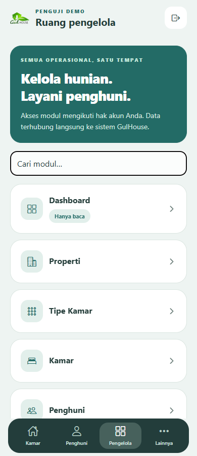
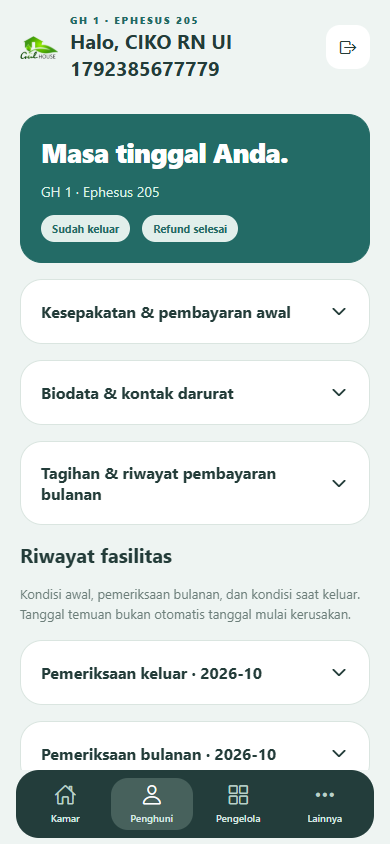

# Penyerahan aplikasi React Native GulHouse — 19 Oktober 2026

**Pembaruan deployment online:** API dan migrasi sudah diterapkan pada 19 Oktober 2026. Status API 404 serta keterbatasan perangkat pada catatan build awal di bawah bersifat historis. Lihat [laporan deployment dan pengujian online](gulhouse-online-mobile-deploy-20261019.md) untuk status terbaru. APK berjalan memakai server online; checksum terbaru tersedia dalam `releases/android/build-receipt.json`.

Aplikasi untuk penghuni dan pengelola tersedia dalam satu proyek React Native/Expo, dengan navigasi dan komponen native, tanpa antarmuka WebView. Desain mengikuti referensi el: warna teal, kartu putih membulat, foto kamar, dan navigasi bawah gelap. Website landing/master existing tetap menjadi backend dan antarmuka web tersendiri.

## Hasil implementasi

- Katalog, filter, detail/foto kamar, informasi biaya/peraturan/FAQ, kontak dan pengajuan survei.
- Identitas awal dengan KTP wajib dan buku nikah opsional; akses penghuni dengan kode pribadi. Biodata lengkap dibuka setelah pembayaran aktual diverifikasi.
- Tagihan, bukti pembayaran privat, status transaksi, keluhan, detail fasilitas dan riwayat scan awal/bulanan/keluar.
- Form fasilitas mencakup 19 item, jumlah/kondisi, kamera/pemilih dokumen, OCR sebagai draft yang harus diverifikasi, tanda tangan fisik dan finalisasi admin, revisi serta maintenance.
- Pemberitahuan keluar H−15, pemeriksaan keluar, checkout, penghitungan deposit/potongan, sengketa dan pembayaran refund dengan bukti; tenggat H+2 memakai kalender WIB.
- Pengelola mendapat 25 modul dengan editor, pencarian/filter/paginasi, aksi sesuai hak akses, dashboard, foto kamar, dokumen/template serta ekspor yang tersedia pada kontrak API.
- Lookup telepon/NIK lama hanya mengizinkan akses tagihan terbatas; tidak memberikan identitas lengkap, scan privat atau hak admin.

## Berkas utama

- `mobile/`: aplikasi, aset, plugin native, konfigurasi APK/AAB dan README menjalankan/build.
- `master/application/controllers/Mobile.php`, `master/application/models/Mobile_service.php`, `master/application/libraries/Mobile_*`: API bearer dan jembatan validasi controller existing.
- `database/patch_gulhouse_mobile_api_20261019.sql`, `scripts/migrate-gulhouse-mobile.php`: migrasi additive eksplisit, backup dan verifikasi hash data existing.
- `scripts/build-gulhouse-android.ps1`: build lokal, kunci release privat, pemeriksaan sertifikat, fingerprint source dan checksum hasil.
- `docs/mobile-api-contract.md`: kontrak API, daftar berkas/prasyarat deploy dan batas kompatibilitas.
- `docs/ciko-mobile-report.md`: laporan QC independen beserta cakupan dan temuan.

## Bukti verifikasi

CIKO menyatakan **QC PASS untuk cakupan API dan React Native Web yang diuji**, tanpa temuan kritis/mayor/medium terbuka. BUBU menangani UI, WASP API/backend, CIKO memeriksa secara independen, dan ZEYN mengintegrasikan transport, build, regresi serta penyerahan. Cakupan perangkat native tetap belum terverifikasi.

Ringkasan komunikasi subagent sesi yang benar-benar berlangsung:

> [CIKO -> ZEYN | Kritik] Kartu akun memakai kolom metadata yang tidak sesuai DTO sehingga nama/status tampak kosong; usulan memperbaiki metadata backend.
>
> [WASP -> ZEYN | Revisi] Kolom dipetakan ke field DTO sebenarnya; 100 pemeriksaan backend lulus.
>
> [CIKO -> ZEYN | Jawaban] Metadata dan kartu UI diperiksa ulang; nama pengguna, peran dan aktif tampil. RN-API08 ditutup, QC PASS pada cakupan yang diuji.

Semua transaksi uji memakai database dan dokumen sintetis terpisah. Data penghuni/keuangan existing tidak dipakai sebagai objek mutasi.

| Pemeriksaan | Hasil/cakupan |
| --- | --- |
| Regresi web existing | 253 pemeriksaan HTTP/database PASS |
| Backend mobile WASP | 100 pemeriksaan API dan 4 serializer PASS |
| Transport native terisolasi | 15 PASS: sesi, stale401, penyimpanan berurutan, MIME unduhan, timeout OCR, kalender WIB |
| Smoke katalog/router | 26 PASS: ukuran layar, CORS, namespace API dan perlindungan source |
| Journey UI bersih | 26/26 PASS: pendaftaran hingga refund dibayar |
| Journey sengketa | 28/28 PASS: potongan disengketakan, refund parsial, pelepasan dan pembayaran sisa |
| Admin | Navigasi/editor 25 modul; create/edit/delete atau disable pada 11 kategori milik run sendiri |
| Media | 20 gambar aktual termasuk 19 file privat; rotasi PNG/JPEG/WebP melalui UI |
| Riwayat/lookup | 7/7 PASS; logout bersamaan dengan login baru 2/2 PASS |
| Layout | 320, 390, 768, 1024 dan 1440 px tanpa overflow pada cakupan audit |
| TypeScript | Pemeriksaan tipe PASS |
| APK release | Build SUCCESS, sertifikat release cocok, 14/14 inspeksi byte/manifest PASS |

Angka di atas berasal dari suite berbeda dan dapat saling beririsan; jangan dijumlahkan sebagai jumlah skenario unik. Bukti lokal tersimpan di `.e2e/mobile/`; runtime/token/kode sintetis privat tidak untuk dibagikan. Rincian tambahan security/resident/surface ada pada laporan CIKO.

Playwright mengoperasikan hasil Expo React Native Web dengan API nyata tanpa mock. Ini membuktikan perilaku UI bersama dan integrasi API dalam browser, **belum membuktikan runtime perangkat Android/iOS**. Instalasi perangkat, kamera/picker native, keyboard, tombol back, sharing/print dan jaringan perangkat belum diuji. Scan sintetis menguji jalur OCR, bukan akurasi tulisan tangan.

## Distribusi dan server

Target Android adalah APK release `id.gulhouse.app` versi 1.0.0 untuk ARM64/ARMv7, agar dapat dibagikan lewat WhatsApp. Konfigurasi default mengarah ke `https://gulhouse.co.id/master/index.php/api/mobile`; tidak memerlukan Metro/Expo Go saat menjalankan APK release. Versi iOS disiapkan pada proyek yang sama, tetapi build/distribusi iOS belum dijalankan dan akun Apple Developer belum tersedia.

Langkah pemasangan/distribusi: [android-distribution.md](android-distribution.md).

Endpoint mobile server online masih mengembalikan 404 pada pemeriksaan baca-saja. Aplikasi memerlukan penerapan API dan migrasi lifecycle/mobile sebelum login serta transaksi pada server online dapat digunakan. Belum ada push, deploy, migrasi produksi atau perubahan database produksi. Persetujuan deploy diminta terpisah sesuai aturan workspace.

Kunci release berada pada direktori privat `.deploy/android-signing` dan tidak dikemas di APK/Git. Kunci ini harus dipertahankan untuk pembaruan APK dengan identitas yang sama. Receipt publik hanya berisi hash, metadata build dan sidik sertifikat.

## Batasan dependency

Audit npm pada dependency template Expo saat ini mencatat 23 advisory (8 moderate, 15 high), terutama dependency toolchain turunan. Tidak dilakukan `audit fix --force` yang akan menurunkan major Expo/RN. Tidak ada klaim dependency bebas kerentanan; detail tersimpan lokal pada `.e2e/mobile/npm-audit.json`. Validasi runtime fisik dan peninjauan dependency lanjutan tetap diperlukan sebelum distribusi operasional luas.

## Artefak Android

**Build final SUCCESS**. APK: [GulHouse-1.0.0.apk](../releases/android/GulHouse-1.0.0.apk), 35.293.279 byte (sekitar 35 MB), Android minimum API24/Android7.0, ARM64 dan ARMv7. Sertifikat APK diverifikasi cocok dengan kunci release privat GulHouse; bukan debug signing.

SHA-256: `c108a8bdc2763679dbcac0df4e6cfb88728cddd84c5478669b8e5f9a1bef81bb`.

Receipt final: [build-receipt.json](../releases/android/build-receipt.json). Pemeriksaan byte APK di `.e2e/mobile/apk-inspection.json`: **14/14 PASS**, mencakup integritas ZIP, dua ABI native, bundle tertanam, API online, tidak ada alamat API sintetis/berkas privat, package/version, non-debuggable, HTTP cleartext/backup dinonaktifkan, checksum dan status signature. Ini inspeksi artefak, bukan uji instalasi/perangkat.

Build pertama berhasil dikompilasi, tetapi guard fingerprint menolak publikasi karena source UI berubah selama proses. Build final diulang setelah source dibekukan dengan native configuration yang sama; source hash sebelum/sesudah cocok. Server PHP sintetis dan preview web milik sesi dihentikan setelah bukti QC disimpan. Tidak ada layanan produksi yang dihentikan.

## Cuplikan UI

### Pembaruan uji tablet fisik

APK 1.0.0 berhasil dipasang melalui ADB pada tablet Samsung SM-X406B milik el, 19 Oktober 2026 sekitar 12:17 WIB. `adb install -r` mengembalikan `Success`; peluncuran `id.gulhouse.app/.MainActivity` mengembalikan `Status: ok`, dan proses tetap hidup sesudah screenshot. Tampilan native awal terlihat pada tablet landscape. Bukti privat lokal: `.e2e/mobile/android-tablet-installed.png`.

Pada saat uji ini, katalog menampilkan error respons API online karena API baru belum dideploy. Jadi yang terverifikasi pada perangkat adalah instalasi dan peluncuran/tampilan awal, bukan login, data online atau transaksi. Kamera/picker/keyboard/back/print/sharing dan alur lengkap pada perangkat tetap belum diverifikasi. Status batasan perangkat pada bagian sebelumnya harus dibaca dengan pembaruan ini.

Cuplikan berikut berasal dari preview React Native Web pada data sintetis, bukan screenshot perangkat fisik.

